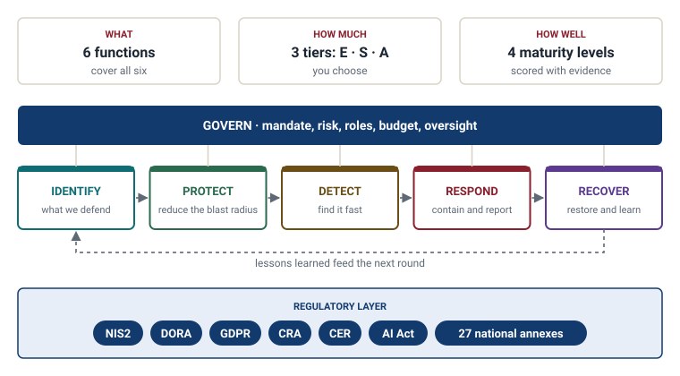
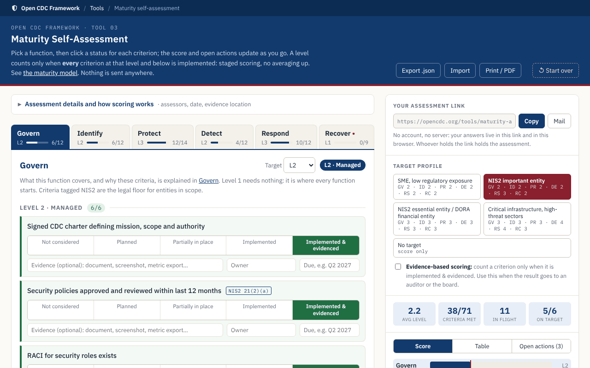
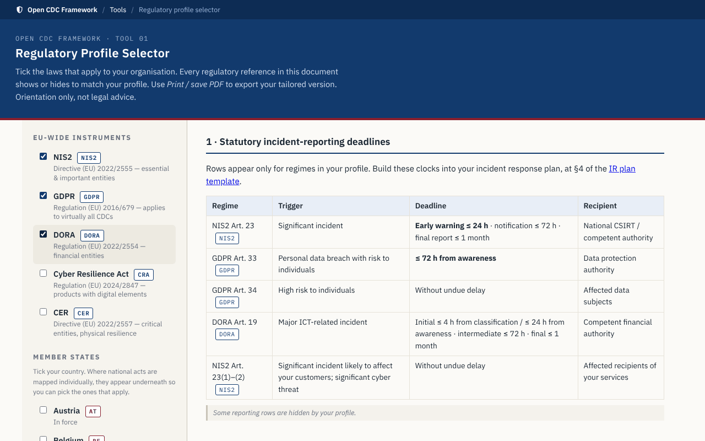
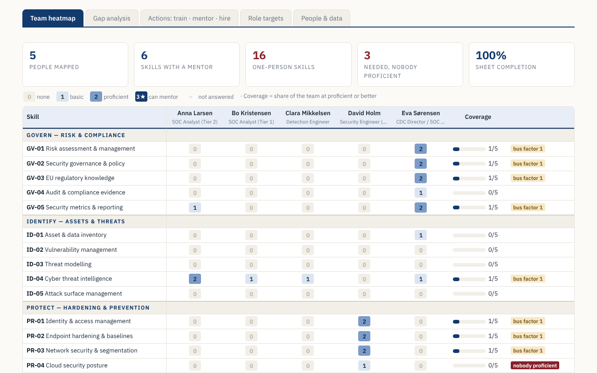

<div align="center">

# Open CDC Framework

**Build and run the team that detects and responds to cyber attacks.**<br>
Written for NIS2, DORA and GDPR · All 27 EU member states · Free to use and adapt

[](CHANGELOG.md)
[](LICENSE)
[](https://opencdc.org/)

**[Read it on opencdc.org](https://opencdc.org/)** · [Where to start](#where-to-start) · [The seven steps](#the-seven-steps) · [Browser tools](#three-browser-tools) · [Changelog](CHANGELOG.md)

</div>

---

Standards say what good security covers, and NIS2 says what you must do. Neither says how to set up the team that does the work, who decides what, or how to tell whether it works. OCDF does, for a 24/7 Cyber Defence Center and for two people in IT who also look after security.

<p align="center">
<picture>
  <source media="(prefers-color-scheme: dark)" srcset="assets/diagrams/readme-at-a-glance-dark.svg">
  
</picture>
</p>

Level 2 in every function covers what NIS2 requires, criterion by criterion. Everything is vendor-neutral, and every statement is marked as law, standard or the author's judgement.

## Where to start

| You are | Start with |
|---------|-----------|
| A small IT-security team of one to three people | [If you are the whole security function](docs/tiers.md#if-you-are-the-whole-security-function) |
| A CISO, board member or sponsor | The 30-minute [executive guide](docs/executive-guide.md) |
| Building a SOC or CDC | [The seven steps](#the-seven-steps) and [operating models](docs/operating-models.md) |
| Running one already | The [maturity self-assessment](https://opencdc.org/tools/maturity-assessment.html) |
| An analyst or engineer | [Alert triage](docs/alert-triage.md), [detection-as-code](docs/detection-as-code-deep-dive.md) and the [CTI deep dive](docs/cti-deep-dive.md) |
| In compliance or legal | The [EU regulatory landscape](docs/eu-regulatory-landscape.md) and your [national annex](docs/annexes/README.md) |

New to the terms? [OCDF on one page](docs/one-page.md) explains them in five minutes. Want to see it applied first? The [worked example](docs/worked-example.md) takes an invented 2,500-person company from no SOC to its first board report.

## The seven steps

Each step leaves you with a document you keep.

| | Step | You come away with |
|---|------|--------------------|
| **Design** | 1. [Choose your tier](docs/tiers.md) | How much of the framework applies to you |
| | 2. [Run the design workshops](assessments/cdc-design-navigator.md) | Gaps and open decisions, logged |
| | 3. [Adopt the charter](templates/cdc-charter-template.md) | A signed mandate with containment authority |
| | 4. [Decide the operating model](docs/operating-models.md) | In-house, provider or hybrid, with staffing numbers |
| **Build** | 5. [Work the first 90 days](docs/start-here.md) | Day-90 exit criteria met; steps 2 to 4 are its first weeks |
| | 6. [Assess where you are](https://opencdc.org/tools/maturity-assessment.html) | A scored baseline, with an owner and a date on every gap |
| **Run** | 7. [Set the operating rhythm](templates/annual-calendar-template.md) | An annual calendar and a growing detection portfolio |

## Three browser tools

Each tool is one HTML file that runs in your browser. No account, and nothing you enter is sent anywhere.

<table>
<tr>
<td width="33%" valign="top">
<a href="https://opencdc.org/tools/maturity-assessment.html"></a><br>
<b><a href="https://opencdc.org/tools/maturity-assessment.html">Maturity self-assessment</a></b><br>
Score every criterion, see your level per function against a target, and resume from a link or a file.
</td>
<td width="33%" valign="top">
<a href="https://opencdc.org/tools/regulatory-profile.html"></a><br>
<b><a href="https://opencdc.org/tools/regulatory-profile.html">Regulatory profile selector</a></b><br>
Tick the EU and national laws that apply and get the reporting deadlines and references that match.
</td>
<td width="33%" valign="top">
<a href="https://opencdc.org/tools/skill-matrix.html"></a><br>
<b><a href="https://opencdc.org/tools/skill-matrix.html">Team skill matrix</a></b><br>
Load the team's self-assessment sheets and see the gaps, the one-person skills, and who to train, mentor or hire.
</td>
</tr>
</table>

## What you can rely on

- **Scope: enterprise IT.** Endpoints, servers, identity, cloud and SaaS; not OT/ICS, telco core networks or classified environments; see [About](ABOUT.md) and [the IT/OT interface](docs/it-ot-interface.md).
- **Not legal advice.** The regulatory content has not had independent legal review, and some national annexes still carry verification flags.
- **Sources marked.** [Why trust this framework](docs/trust.md) says which statements are law, which are standards and which are judgement, and every source is credited in [references](docs/references.md).

<details>
<summary><b>What is in this repository</b></summary>

| Folder | Contents |
|--------|----------|
| [`docs/`](docs/README.md) | The framework: functions, lenses, operations, deep dives and the regulatory layer, with an [index in reading order](docs/README.md) |
| [`docs/annexes/`](docs/annexes/README.md) | One annex per member state, each with its review date and confidence, edited in `countries.json` |
| [`assessments/`](assessments/) | The design navigator and the maturity checklist, the single source of the criteria |
| [`templates/`](templates/README.md) | Charter, IR plan, playbooks, use case, KPIs, job description, MSSP checklist, containment catalogue, controls register, annual calendar and the skill sheet |
| [`tools/`](tools/README.md) | The three browser tools, and the scripts that build diagrams and country data and check consistency |
| `site/`, `overrides/`, `mkdocs.yml` | The website build |

</details>

<details>
<summary><b>Build the website locally</b></summary>

```
pip install -r requirements-site.txt
python tools/check_consistency.py
python site/build_site.py
mkdocs serve
```

</details>

## Contributing, security and citing

Corrections, national-law mappings and field feedback are welcome; see [Contributing](CONTRIBUTING.md). Report security problems in the site or the tools privately, as described in [Security](SECURITY.md).

To cite: *Open CDC Framework (OCDF), version 1.3.0, 2026. Licensed CC BY 4.0. Available at: https://github.com/p0jst/OpenCDC.*

## About

Written by Frederik B. Krogsgaard, formerly Senior Manager at the Norlys Cyber Defence Center, after a decade in the field and four years building and running a 24/7 CDC. The story and how the project is maintained: [About](ABOUT.md).

Licensed under [CC BY 4.0](LICENSE): free to use, share and adapt, also commercially, with credit. OCDF builds on public work by NIST, ENISA, MITRE, FIRST and others and is not endorsed by any of them.
